<!-- ============================================================
     Profile README for github.com/thedalycreative
     Screenshots: /assets/screens  ·  Custom icon tiles: /assets/icons
     ============================================================ -->

 

 

---

## About me

**Trainer & Industry Specialist** at **EQC Institute of Technology** (Equinim College) by day, **founder of The Daly Creative** the rest of the time. Seven-plus years shipping tech across government, corporate and creative sectors, sitting on top of a twenty-year career of keeping people calm while things are on fire.

- I teach the **front-end web development** and **client relations** units of the Diploma of IT (Back-End Web Development), which means I explain flexbox roughly 40 times a week and still enjoy it.
- Through **The Daly Creative** I build brand identities, React/Tailwind sites and Claude-powered automations for small businesses who "just have a quick idea".
- Before that I wrangled **HR systems at the Department of Transport** and **court technology at the Supreme Court of WA**, where "have you tried turning it off and on again" has a much bigger audience.
- I care about semantic HTML, real accessibility (not Lighthouse-score cosplay) and code comments my students can actually follow.

 

---

## Tech stack

<h4>Front end</h4>

<table>
<tr><td align="center" width="96"> <b>HTML</b></td><td align="center" width="96"> <b>CSS</b></td><td align="center" width="96"> <b>JavaScript</b></td><td align="center" width="96"> <b>TypeScript</b></td><td align="center" width="96"> <b>React</b></td></tr>
<tr><td align="center" width="96"> <b>Next.js</b></td><td align="center" width="96"> <b>Tailwind</b></td><td align="center" width="96"> <b>Bootstrap</b></td><td align="center" width="96"> <b>Vite</b></td><td align="center" width="96"> <b>Three.js</b></td></tr>
</table>

<h4>Back end & data</h4>

<table>
<tr><td align="center" width="96"> <b>Node.js</b></td><td align="center" width="96"> <b>Express</b></td><td align="center" width="96"> <b>MongoDB</b></td><td align="center" width="96"> <b>Supabase</b></td><td align="center" width="96"> <b>PostgreSQL</b></td><td align="center" width="96"> <b>Firebase</b></td></tr>
</table>

<h4>AI tools</h4>

<table>
<tr><td align="center" width="96"> <b>Claude</b></td><td align="center" width="96"> <b>Gemini</b></td><td align="center" width="96">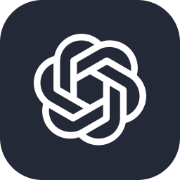 <b>ChatGPT</b></td><td align="center" width="96">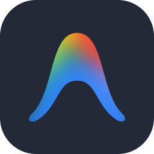 <b>Antigravity</b></td></tr>
</table>

<h4>Dev tools & shipping</h4>

<table>
<tr><td align="center" width="96"> <b>VS Code</b></td><td align="center" width="96"> <b>Git</b></td><td align="center" width="96"> <b>GitHub</b></td><td align="center" width="96"> <b>GitHub Actions</b></td></tr>
<tr><td align="center" width="96"> <b>Docker</b></td><td align="center" width="96"> <b>Postman</b></td><td align="center" width="96"> <b>Vercel</b></td><td align="center" width="96"> <b>Netlify</b></td></tr>
</table>

<h4>Systems & infrastructure</h4>

<table>
<tr><td align="center" width="96"> <b>Azure</b></td><td align="center" width="96">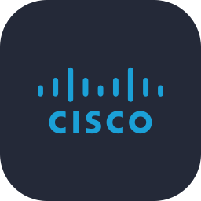 <b>Cisco</b></td><td align="center" width="96"> <b>UTM</b></td><td align="center" width="96"> <b>Windows</b></td><td align="center" width="96"> <b>macOS</b></td></tr>
</table>

<h4>Design</h4>

<table>
<tr><td align="center" width="96"> <b>Illustrator</b></td><td align="center" width="96"> <b>Photoshop</b></td></tr>
</table>

 

 

---

## Where I've done the tech things

### Founder & Creative Director
**The Daly Creative** &nbsp;·&nbsp; `Feb 2025 – now`
- Full client lifecycle: scoping, design systems, React/Tailwind builds, deployment on Vercel/Netlify/GitHub Pages, and ongoing support.
- Built reusable **Claude-based skills and automated workflows** for client and internal use.
- Delivered sites and brand systems across hospitality, health, framing, music, acting and trades.

### Trainer & Industry Specialist
**EQC Institute of Technology (Equinim College, RTO 45758)** &nbsp;·&nbsp; `Oct 2025 – now`
- Teach the **front-end web development** and **client relations** units of the Diploma of IT (Back-End Web Development): HTML/CSS/JS, responsive layout, Bootstrap, Git, plus scoping briefs and managing client expectations.
- Built student-facing tools: an interactive **Three.js 3D campus map**, rendered floor plans, digital signage and HTML slide decks.
- Run a dedicated **student hub site for every intake** (see below).

### Technology Administrator
**Department of Transport WA** &nbsp;·&nbsp; `Jun 2024 – Jan 2025`
- Administered **Oracle DayForce** (payroll/HCM) and **ELMO** (LMS) for a department-wide user base; 2IC in a team of six.
- **Cut the online-training update cycle by ~20%** through process redesign.
- **Automated staff notifications** for banking-detail changes, reducing inbound HR queries.
- Shipped in-house **Employee Self Service** updates, so fewer expensive calls to Oracle support.

### Court Technology & Resource Officer
**Supreme Court of WA (Department of Justice)** &nbsp;·&nbsp; `Jul 2023 – May 2024`
- Led the build and launch of the **Supreme Court staff intranet**.
- Moved courtroom booking from manual to an **integrated digital calendar system**.
- First responder for **courtroom AV and system failures**. Debugging with an audience that includes the Chief Justice is a special kind of pressure.

<b>The prequel (2003 – 2022): the bit that taught me to stay calm under pressure</b>

 

<h4>Court Support Officer &nbsp;·&nbsp; WA District Court</h4>
Tightened civil subpoena workflows end to end.

<h4>Resident Support Team Leader &nbsp;·&nbsp; COVID-19 Quarantine Victoria</h4>
Ran a team of 60+, rolled out policy and SOP updates on Microsoft 365.

<h4>Digital Solutions Specialist &nbsp;·&nbsp; White Pages / Sensis</h4>
Sold and supported small-business digital adoption, built performance metrics, ran remote training. Top Overall Performer.

<h4>Customer Retention Specialist &nbsp;·&nbsp; Medibank</h4>
Designed process workflows for the sales team.

<h4>Cabin Crew &nbsp;·&nbsp; Jetstar Airways</h4>
A320/A321 safety and service; 98% exam average; National Employee of the Month.

<h4>Senior Technical Support &nbsp;·&nbsp; Westnet / iiNet</h4>
Escalations, advanced troubleshooting, onboarding new techs. The "turn it off and on again" years.

<h4>Presenter & Production Director &nbsp;·&nbsp; RTRfm 92.1</h4>
Scripting, live panels, audio editing; three community media awards.

 

---

## Client work &nbsp;via The Daly Creative

<table>
<tr>
<td width="50%" valign="top">
<a href="https://liam-graham-actor.vercel.app">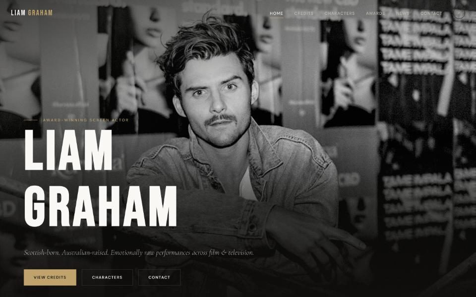</a>
 <b><a href="https://github.com/thedalycreative/liam-graham-actor">Liam Graham — Actor</a></b> 
Bespoke editorial portfolio for a Scottish-born Australian screen actor. Moody, monochrome, very serious. Unlike this README.
  
</td>
<td width="50%" valign="top">
<a href="https://matt-walford-music.vercel.app">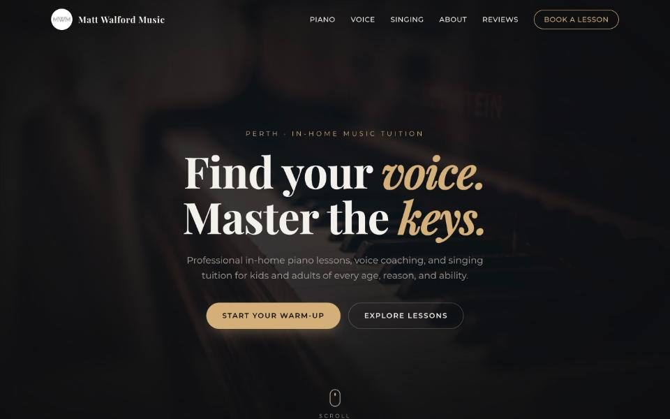</a>
 <b><a href="https://github.com/thedalycreative/matt-walford-music">Matt Walford Music</a></b> 
Lesson-booking site for a Perth piano and voice teacher. Pitch-perfect, unlike my singing.
  
</td>
</tr>
<tr>
<td width="50%" valign="top">
<a href="https://renter-rights-hub.vercel.app">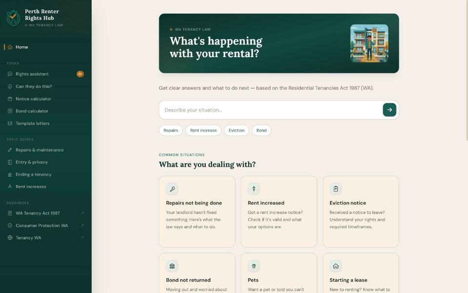</a>
 <b><a href="https://github.com/thedalycreative/renter-rights-hub">Perth Renter Rights Hub</a></b> 
Plain-English WA tenancy law, powered by <b>Gemini 2.5 Flash</b>: an AI rights assistant, notice and bond calculators, and template letters for when the landlord "will get to it next week".
   
</td>
<td width="50%" valign="top">
<a href="https://family-drug-support-information-for.vercel.app">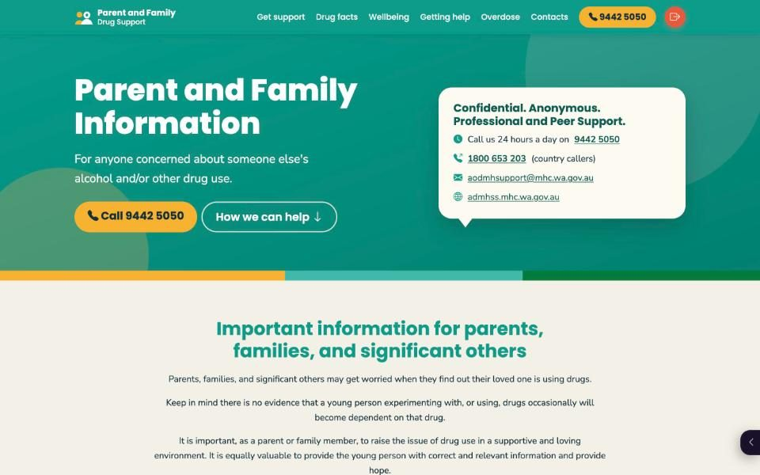</a>
 <b><a href="https://github.com/thedalycreative/family-drug-support-information-for-families">Parent & Family Drug Support</a></b> 
Accessible information hub for families supporting a loved one, with one-tap calling and a quick-exit button. No jokes on this one.
  
</td>
</tr>
<tr>
<td width="50%" valign="top">
<a href="https://fish-and-chips-shop-cloverdale.vercel.app">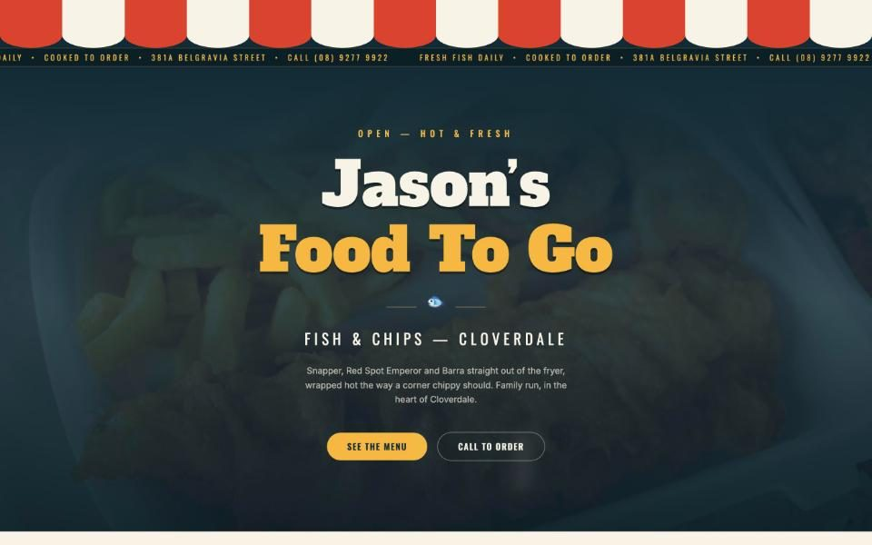</a>
 <b><a href="https://github.com/thedalycreative/jasons-fish-and-chips">Jason's Food To Go</a></b> draft 
Corner-chippy site for Cloverdale, complete with a striped awning. Warning: may cause sudden cravings for a potato cake.
  
</td>
<td width="50%" valign="top">
<a href="https://project-u59ql.vercel.app">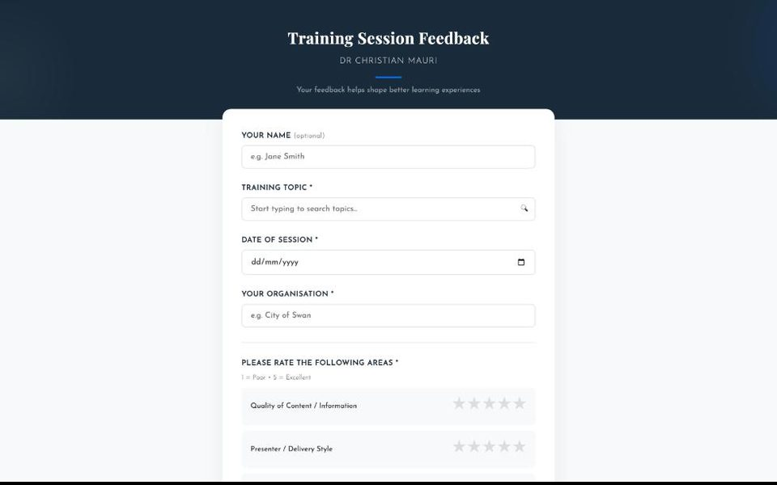</a>
 <b><a href="https://project-u59ql.vercel.app">Dr Christian Mauri — Session Feedback</a></b> 
Training-session feedback form with searchable topics and star ratings, built so attendees actually finish it. One page, zero friction.
  
</td>
</tr>
<tr>
<td width="50%" valign="top">
<a href="https://dorahealth-website-2026.vercel.app">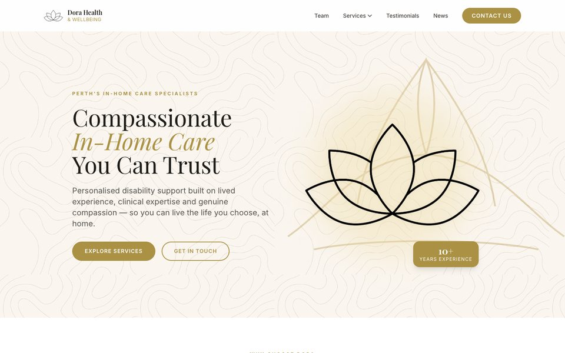</a>
 <b><a href="https://dorahealth-website-2026.vercel.app">Dora Health & Wellbeing</a></b> 
End-to-end branding, website, style guide and digital ecosystem for a Perth in-home care startup. Calm, dignified and very lotus-forward.
  
</td>
<td width="50%" valign="top">
<a href="https://www.wcepros.com">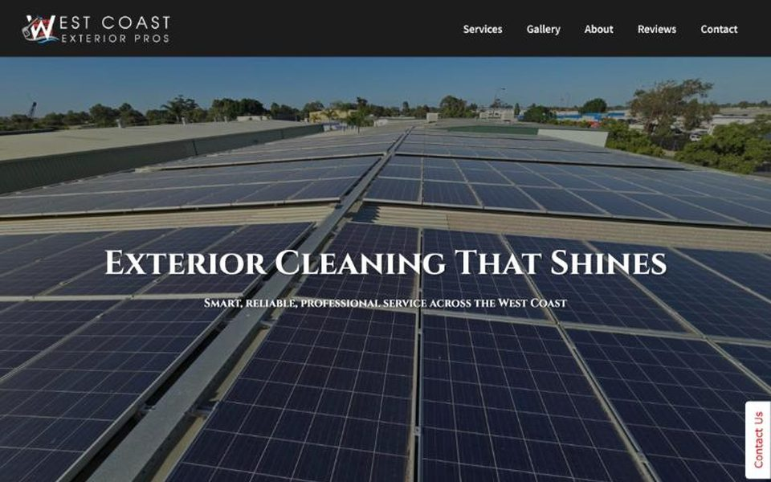</a>
 <b><a href="https://www.wcepros.com">West Coast Exterior Pros</a></b> 
Trades site for an exterior-cleaning business. Their solar panels are cleaner than my Git history.
  
</td>
</tr>
<tr>
<td width="50%" valign="top">
<a href="https://www.preservationframers.com.au">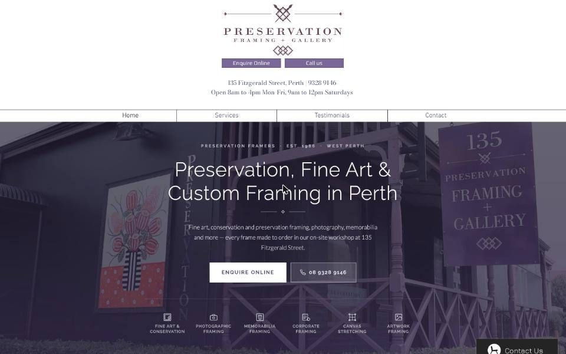</a>
 <b><a href="https://www.preservationframers.com.au">Preservation Framers</a></b> 
Brand refresh and site for a West Perth framing studio operating since 1986. I framed their content. Sorry.
 
</td>
<td width="50%" valign="middle" align="center"> Me, on every client kickoff call.</td>
</tr>
</table>

---

## My website

<table>
<tr>
<td width="50%" valign="top">
<a href="https://thedalycreative.com">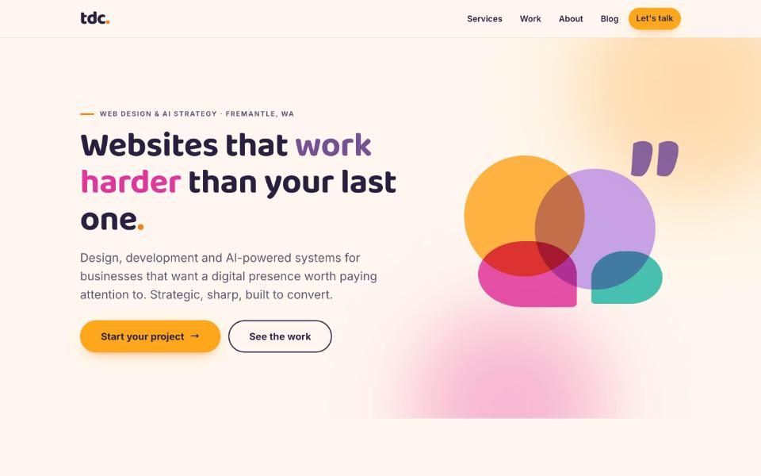</a>
 <b><a href="https://thedalycreative.com">The Daly Creative</a></b> &nbsp;thedalycreative.com 
My studio site, v27: the 2026 revamp with a "sunset overprint" design system. "Websites that work harder than your last one." Also works harder than me on Fridays. Source: <code>tdc-2026-agency-site</code> and <code>tdc-website-v27</code> (private), plus the older <a href="{GH}tdc-site">tdc-site</a>.
   
</td>
<td width="50%" valign="top" align="center">
 

  
<b><a href="https://github.com/thedalycreative/tim-daly-cv">tim-daly-cv</a></b> 
My online CV, deployed to GitHub Pages. The cat wrote the cover letter.
  
</td>
</tr>
</table>

---

## Teaching at EQC

Everything I've built for (and with) my diploma students. Mostly working. Very proud.

### Featured: EQC Perth Campus Dashboard

**[EQC Perth Campus Dashboard](https://github.com/thedalycreative/eqc-welcome-board)**: one system, three very different screens, each designed around the device it actually runs on. Built with Intake 25g, and now the first thing every visitor to the Perth campus sees. No pressure, team.

<a href="https://www.perth-eqc.xyz/">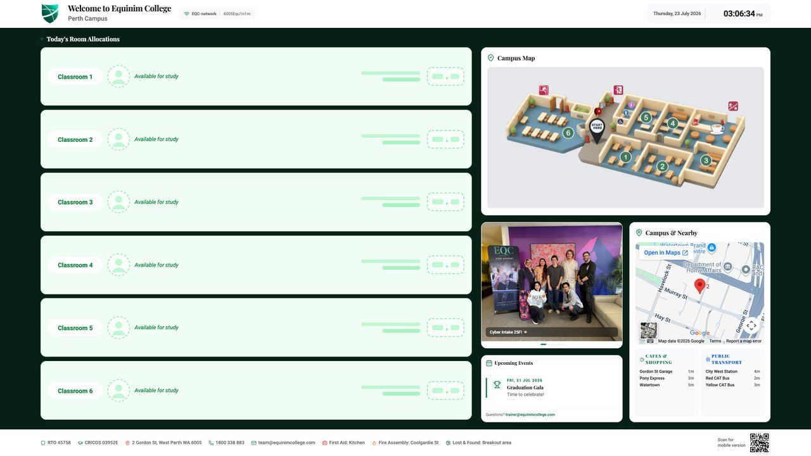</a>
<b>Lobby welcome board</b> &nbsp;·&nbsp; wall-mounted, fixed 1920×1080. Room allocations, campus map, live clock, news ticker, photo carousel and a QR code that hands visitors the mobile version. Legible from across the room; nobody touches it.

<table>
<tr>
<td width="50%" valign="top">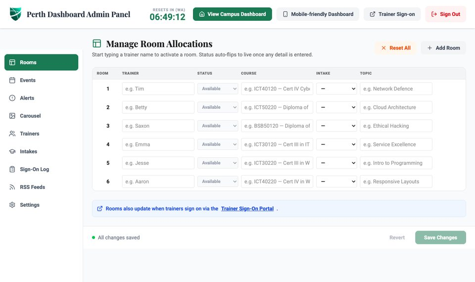 <b>Admin panel</b> &nbsp;responsive, any device Nine tabs behind a login (rooms, events, alerts, carousel, intakes, RSS, settings) that write straight to the lobby board. Trainers use it from a laptop, an iPad in the corridor or a phone between classes.</td>
<td width="25%" valign="top" align="center">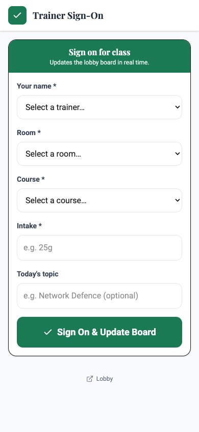 <b>Trainer sign-on</b> Phone at the classroom door: name, room, course, intake, today's topic. The lobby board updates in real time.</td>
<td width="25%" valign="top" align="center">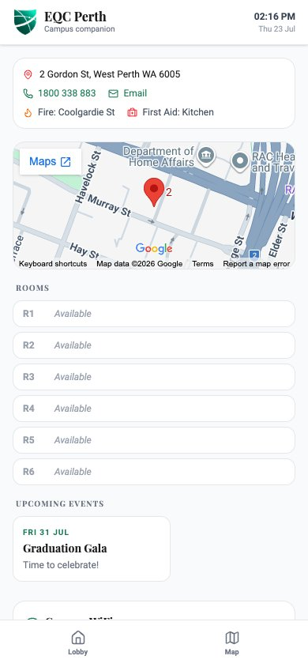 <b>Campus companion</b> Scan the QR: room availability, maps, emergency info and contacts, all in thumb reach.</td>
</tr>
</table>

 

### Student Hubs

Every intake gets its own hub: class links, cheat sheets, schedules and code, all in one bookmark.

<table>
<tr>
<td width="50%" valign="top">
<a href="https://intake-25g-dashboard.vercel.app">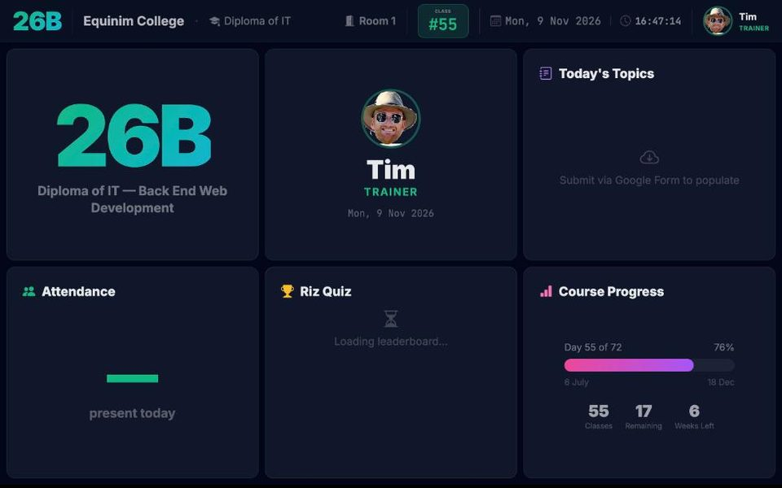</a>
 <b><a href="https://intake-25g-dashboard.vercel.app">Intake 25g Classroom Dashboard</a></b> 
Live classroom dashboard: class number, trainer, today's topics, attendance, a Riz Quiz leaderboard and course progress. Built for 25g, and the template now runs 26B too.
  
</td>
<td width="50%" valign="top">
<a href="https://eqc-intake-25g.vercel.app">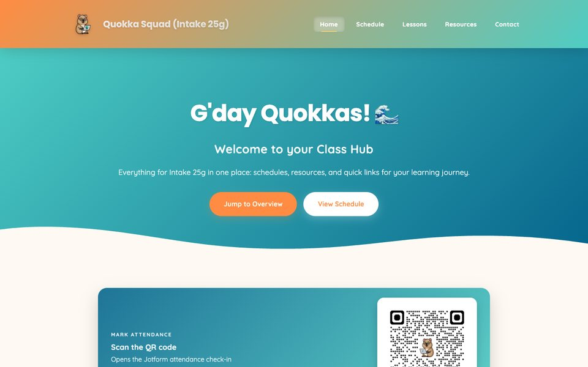</a>
 <b><a href="https://eqc-intake-25g.vercel.app">Quokka Squad (Intake 25g)</a></b> 
"G'day Quokkas!" A friendly landing pad for the intake: schedules, resources, quick links and a QR attendance check-in.
  
</td>
</tr>
<tr>
<td width="50%" valign="top">
<a href="https://class-page-inky.vercel.app">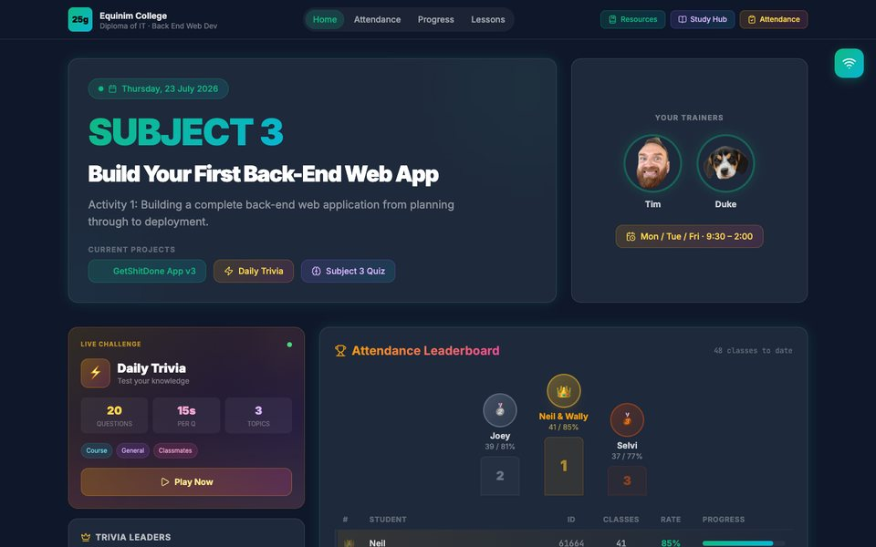</a>
 <b><a href="https://class-page-inky.vercel.app">Class Page (Intake 25g)</a></b> 
Subject-by-subject project briefs, a daily trivia game and an attendance leaderboard. Turning up on time has never been so competitive.
 
</td>
<td width="50%" valign="top">
<a href="https://thedalycreative.github.io/eqc-hub-2523/">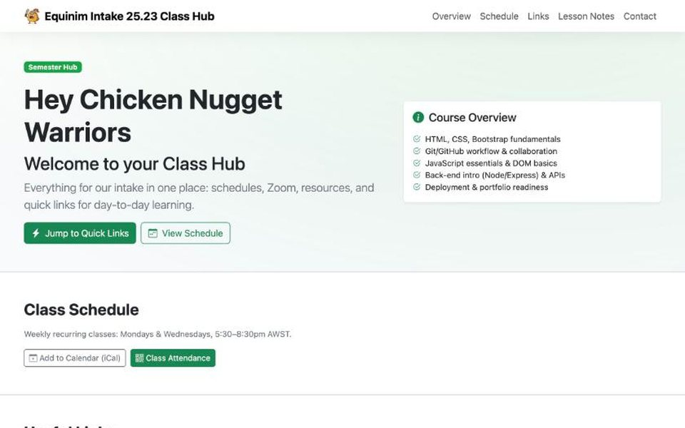</a>
 <b><a href="https://github.com/thedalycreative/eqc-hub-2523">Intake 25.23 Class Hub</a></b> 
"Hey Chicken Nugget Warriors." Semester hub for the Back-End Web Dev intake: class schedule with iCal export, attendance, Zoom, useful links and lesson notes.
  
</td>
</tr>
<tr>
<td width="50%" valign="top">
<a href="https://eqc-26b-classhub.vercel.app">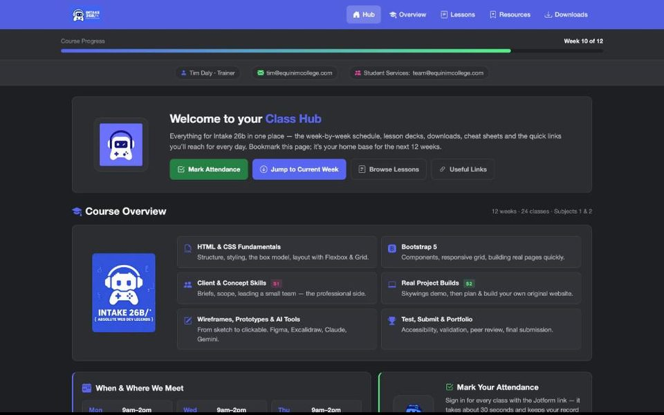</a>
 <b><a href="https://eqc-26b-classhub.vercel.app">Intake 26b Class Hub</a></b> 
Week-by-week schedule, lesson decks, downloads, cheat sheets and attendance for the "Absolute Web Dev Legends". 12 weeks, 24 classes.
  
</td>
<td width="50%" valign="top">
<a href="https://eqc-2613-classhub.vercel.app">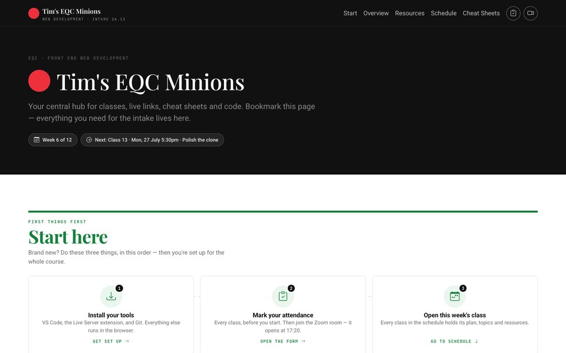</a>
 <b><a href="https://github.com/thedalycreative/eqc-hub-2613">Tim's EQC Minions (Intake 26.13)</a></b> 
Class hub for Apple <i>and</i> Windows warriors: setup guide, attendance, weekly classes, resources and cheat sheets. 24 classes, course complete.
   
</td>
</tr>
</table>

### Classroom Projects

<table>
<tr>
<td width="33%" valign="top">
<a href="https://eqc-25g-quokkascareers.vercel.app">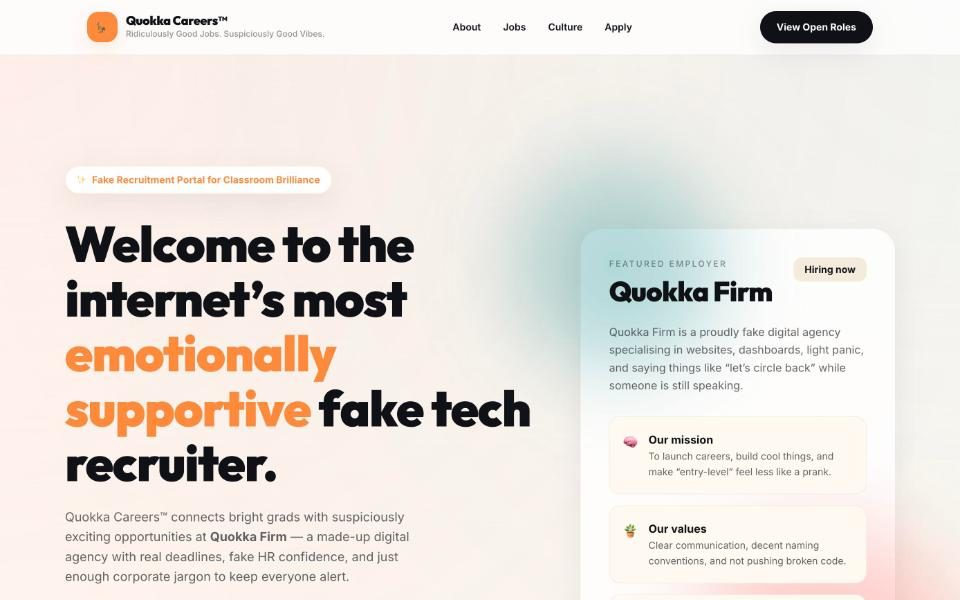</a>
 <b><a href="https://github.com/thedalycreative/quokka-careers">Quokka Careers</a></b> 
"The internet's most emotionally supportive fake tech recruiter." Students roleplay applying for jobs at a made-up agency.
 
</td>
<td width="33%" valign="top">
<a href="https://perthpaws.xyz">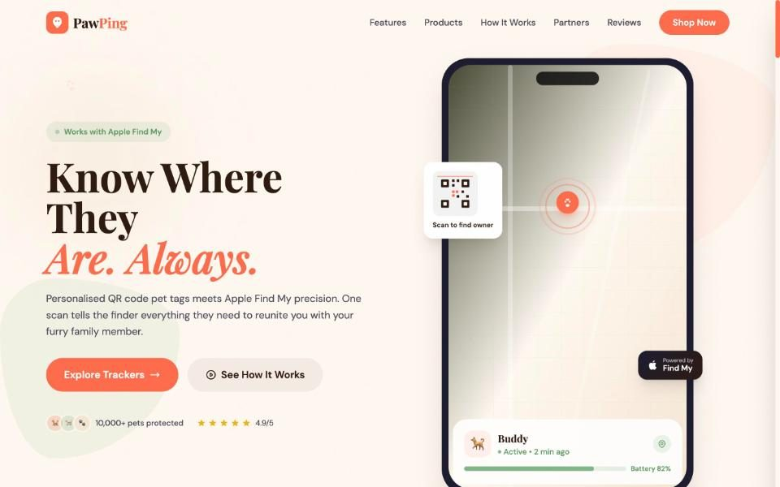</a>
 <b><a href="https://github.com/thedalycreative/perth-paws">PawPing (Perth Paws)</a></b> 
Demo pet-tracker landing page for layout and responsive patterns. Know where they are. Always. (Unlike my students at 9am.)
 
</td>
<td width="33%" valign="top">
<a href="https://thedalycreative.github.io/whipped-and-saddled-co/">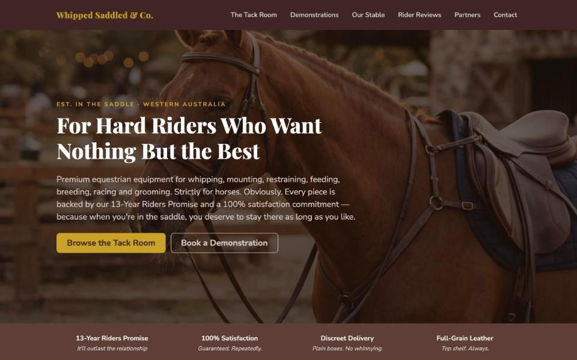</a>
 <b><a href="https://github.com/thedalycreative/whipped-and-saddled-co">Whipped Saddled & Co.</a></b> 
A straight-faced premium equestrian tack store. Strictly for horses. Obviously. A lesson in brand voice.
 
</td>
</tr>
<tr>
<td width="33%" valign="top">
<a href="https://www.eqc-26b.xyz">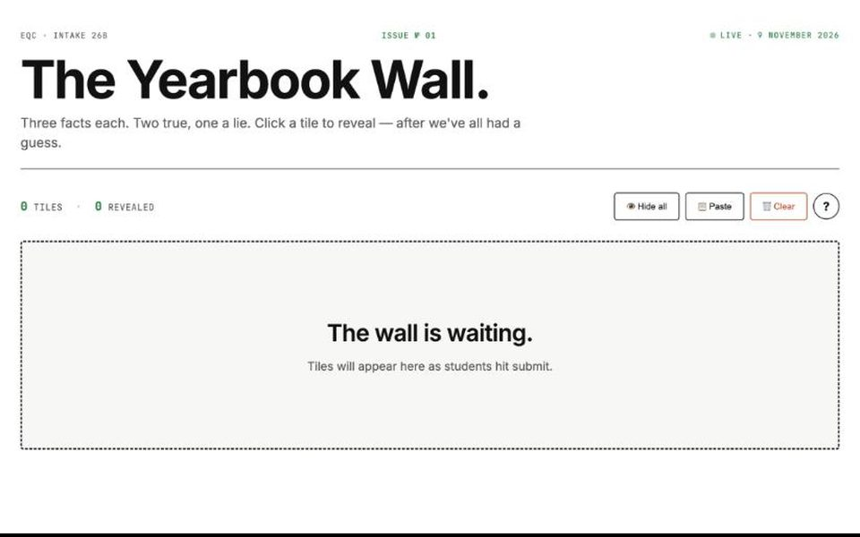</a>
 <b><a href="https://www.eqc-26b.xyz">The Yearbook Wall</a></b> 
First-day icebreaker for 26B: two truths and a lie each, click to reveal. Friendships made, lies exposed.
 
</td>
<td width="33%" valign="top">
<a href="https://webdev-bootstrap.vercel.app">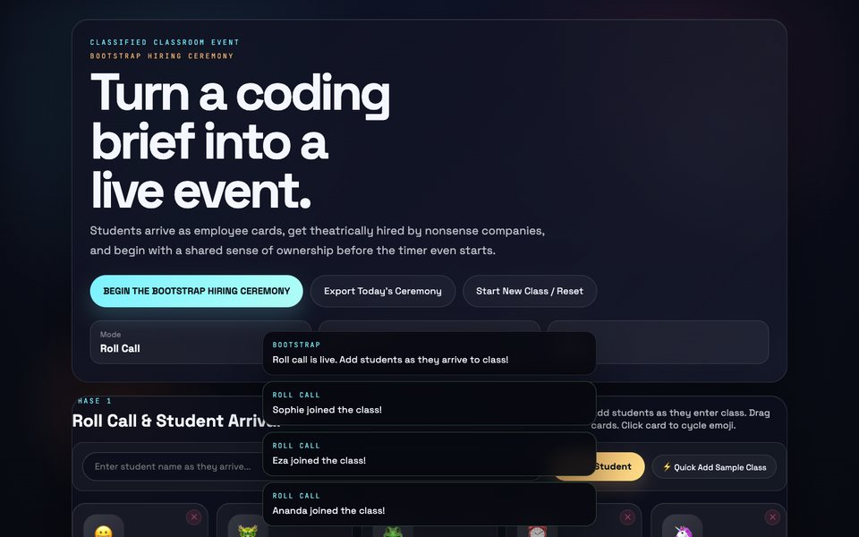</a>
 <b><a href="https://webdev-bootstrap.vercel.app">Bootstrap Hiring Ceremony</a></b> 
Students arrive as employee cards and get theatrically "hired" by nonsense companies before the timer starts. HR has concerns.
 
</td>
<td width="33%" valign="top">
<a href="https://skywings-activity.vercel.app">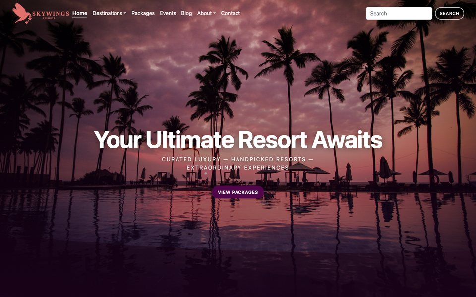</a>
 <b><a href="https://skywings-activity.vercel.app">SkyWings</a></b> 
Luxury resort demo for the 26b Bootstrap build-along. Your ultimate resort awaits. So does your assignment.
 
</td>
</tr>
</table>

**Also in the classroom**

- [Harry Potter: Forbidden Forrest](https://github.com/thedalycreative/harry-potter-forbidden-forrest): Bootstrap clone assignment ([live](https://hp-forbidden-forest-clone.vercel.app))
- [GetStuffDone v3](https://github.com/thedalycreative/eqc-getstuffdone-v3): full-stack to-do app, teaching material for the intro back-end units
- [GetStuffDone v2](https://github.com/thedalycreative/eqc-getstuffdone-v2): beginner-friendly to-do app for learning back-end basics
- [slot-pick](https://github.com/thedalycreative/slot-pick): classroom project
- [apple-clone-bootstrap](https://github.com/thedalycreative/apple-clone-bootstrap): Bootstrap clone exercise
- [eqc-cv-jarrahd-gibson-25g](https://github.com/thedalycreative/eqc-cv-jarrahd-gibson-25g): resume/CV site built for an Intake 25g student
- [flexbox-exercise](https://github.com/thedalycreative/flexbox-exercise): flexbox drills for 26.13
- [nib-health-cover](https://github.com/thedalycreative/nib-health-cover): layout exercise

Pictured: me, reviewing 28 pull requests titled "final-final-v3".

 

---

## Games &nbsp;productivity's natural predator

<table>
<tr>
<td width="33%" valign="top" align="center">
<a href="https://skwerdiality-game.vercel.app">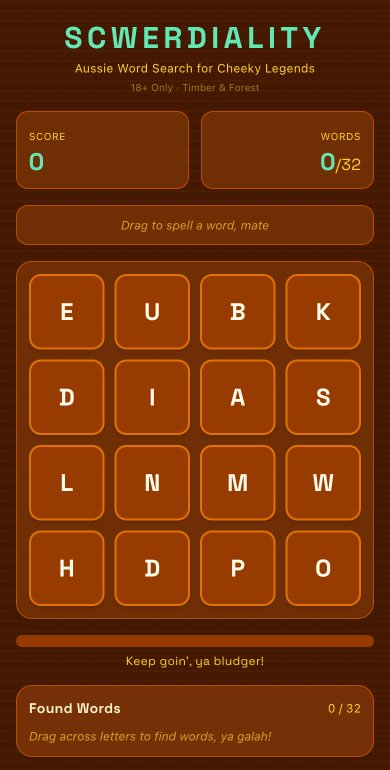</a>
 <b><a href="https://github.com/thedalycreative/sqwerdle-game">Scwerdiality (Sqwerdle)</a></b> 
Aussie word search for cheeky legends. Drag to spell a word, mate. Hints come with the appropriate amount of "ya galah". New colour theme every board.
  
</td>
<td width="33%" valign="top" align="center">
<a href="https://shockdave.xyz">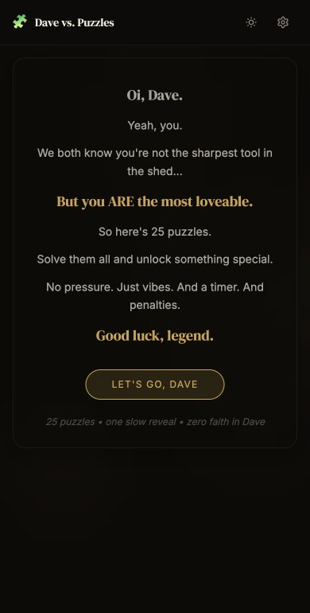</a>
 <b><a href="https://github.com/thedalycreative/game-shockwave">Shockwave: Dave vs. Puzzles</a></b> 
A 25-puzzle birthday gift with cooldowns, penalties and confetti. "We both know you're not the sharpest tool in the shed." Zero faith in Dave was in the spec.
 
</td>
<td width="33%" valign="top" align="center">
<a href="https://see-you-next-tuesday-six.vercel.app">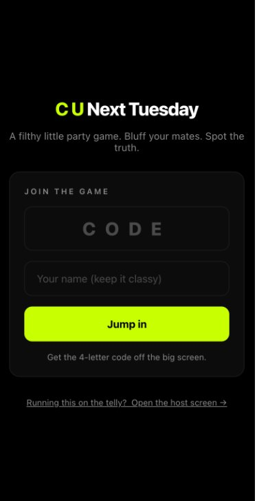</a>
 <b><a href="https://see-you-next-tuesday-six.vercel.app">C U Next Tuesday</a></b> 
Party game: join with a 4-letter code from the big screen, bluff your mates, spot the truth. Big party-game energy, questionable name.
  
</td>
</tr>
</table>

<table>
<tr>
<td width="50%" valign="top">
<a href="https://nugget-warriors-party.vercel.app">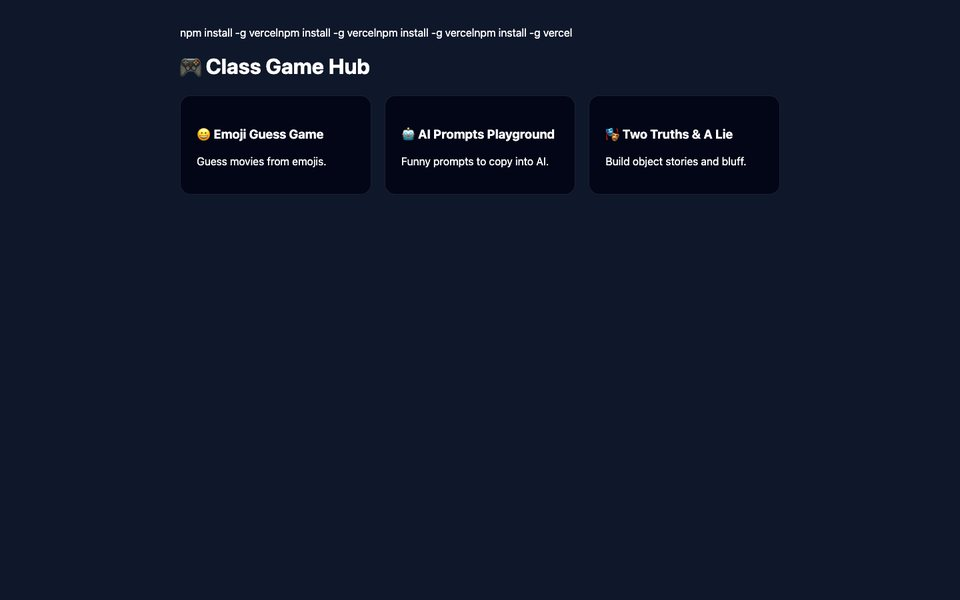</a>
 <b><a href="https://nugget-warriors-party.vercel.app">Class Games Hub</a></b> 
Emoji movie guessing, an AI prompts playground and two-truths-and-a-lie, bundled for class breaks. Officially "engagement activities".
 
</td>
<td width="50%" valign="top">
<a href="https://ask-game.vercel.app">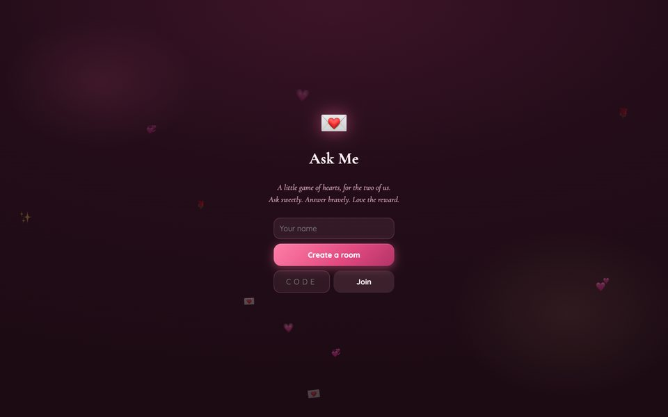</a>
 <b><a href="https://ask-game.vercel.app">Ask Me</a></b> 
Conversation-starter game: pick a pack, get a question, keep the chat going. Awkward silences, eliminated.
 
</td>
</tr>
</table>

---

## Side projects &nbsp;a.k.a. what I do instead of sleeping

<a href="https://pink-power-ranger-alex.vercel.app">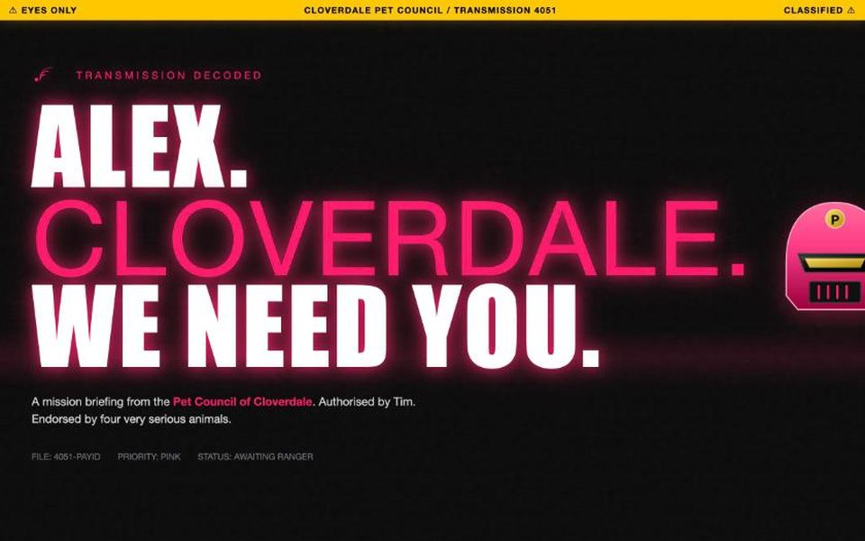</a>

**[Pink Ranger of Cloverdale](https://github.com/thedalycreative/pink-power-ranger)**: a classified mission briefing from the Pet Council of Cloverdale. Recipient: Alex. Priority: pink. Endorsed by four very serious animals. Neon glow, classified stamps, zero chill.

 

**Also brewing**

- [Zebra Jukebox](https://github.com/thedalycreative/zebra-jukebox): side project, currently tuning up
- [Away With The Fairies](https://github.com/thedalycreative/away-with-the-fairies-proposal): pitch site for a podcast proposal

---

## Debugging philosophy

1. Read the error message. Actually read it.
2. `console.log("here")`, `console.log("here2")`, `console.log("WHY")`.
3. Explain it to a rubber duck, or a room of diploma students. Same result, more eye contact.
4. Realise it was a missing comma.
5. Write a comment so future-me doesn't do it again. Future-me does it again.

 

---

## Education & certs

| | Qualification | Where | When |
|---|---|---|---|
|  | Bachelor of Business Administration (Marketing) | Torrens University Australia | 2021 – 2025 (completing) |
|  | Diploma of Information Technology (Back-End Web Development) | Equinim College (EQC) | 2024 – 2025 |
|  | Diploma of Information Technology (Cyber Security) | Equinim College (EQC) | 2025 |
|  | FNS30111 Certificate III in Financial Services | IAG Registered Training Organisation | 2012 – 2013 |
|  | LMF50408 Diploma of Interior Design and Decoration (units completed) | Central TAFE Perth | 2008 – 2009 |
|  | WACE, Year 12. School Captain; Top Graduating Student in English and Media Production | South Fremantle SHS | 2003 – 2007 |

**Licences & certifications**

---

<h3>Got a brief, a training gig or a "we have an idea, can you make it real?"</h3>

Former student? Say hi. I promise not to ask about your commit messages.

